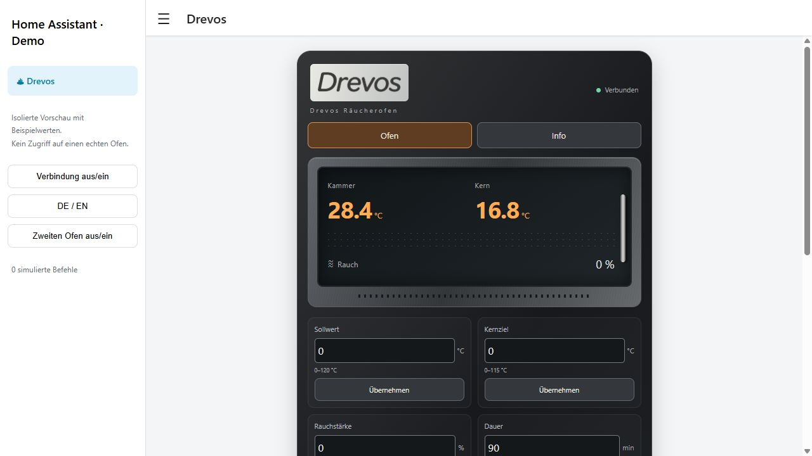
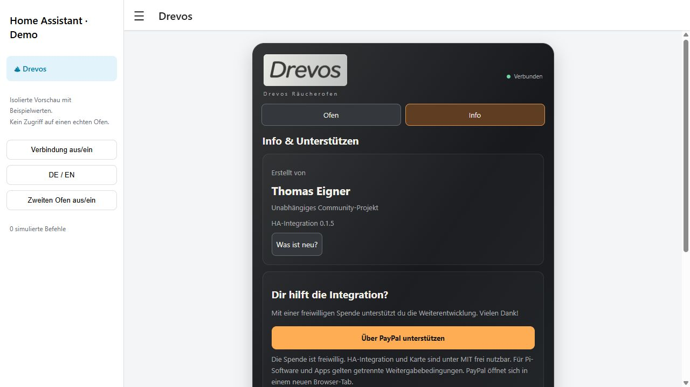

# Drevos Smoker – deutsche Anleitung

<!-- ha-marketplace:exclude-start -->
<p align="center">
  <a href="https://my.home-assistant.io/redirect/marketplace_repository/?owner=eignerth2010-byte&amp;repository=drevos-home-assistant&amp;category=integration"></a>
</p>

<p align="center">
  <a href="https://github.com/eignerth2010-byte/drevos-home-assistant/releases/latest"></a>
  <a href="https://my.home-assistant.io/redirect/marketplace_repository/?owner=eignerth2010-byte&amp;repository=drevos-home-assistant&amp;category=integration"></a>
  <a href="https://github.com/eignerth2010-byte/drevos-home-assistant/blob/main/LICENSE"></a>
  <a href="https://github.com/eignerth2010-byte/drevos-home-assistant/blob/main/README.de.md"></a>
  <a href="https://github.com/eignerth2010-byte/drevos-home-assistant/discussions"></a>
</p>

Home Assistant 2026.11+: Marketplace · [Für ältere HACS-Installationen öffnen](https://my.home-assistant.io/redirect/hacs_repository/?owner=eignerth2010-byte&repository=drevos-home-assistant&category=integration).
<!-- ha-marketplace:exclude-end -->

**Lizenzen:** HA-Integration und Karte bleiben unter [MIT](LICENSE) frei nutzbar und weitergebbar. Nur Pi-Software und Apps benötigen für Verkauf oder kommerzielle Weitergabe Thomas Eigners schriftliche Freigabe. [Genaue Abgrenzung](docs/LICENSING.md).

**[Einfache Schritt-für-Schritt-Installation für Pi und HA](docs/INSTALLATION.de.md)** · **[HA schon da oder App schon da – was zusätzlich nötig ist](docs/HA-UND-APP.de.md)**

[English](README.en.md) · [Projektübersicht](README.md)

Diese Integration verbindet Home Assistant direkt über das Heimnetz mit einem Raspberry Pi am Drevos-Räucherofen. Der Pi spricht mit der vorhandenen SPS.

Das Projekt unterstützt das geprüfte Profil `drevos_fx3u_v1`. Es ist eine unabhängige Community-Integration. Gleiche Marke bedeutet nicht automatisch gleiche Steuerung. Die SPS muss zum [Registerprofil](docs/REGISTER_PROFILE.md) passen. Die vorhandenen Temperaturbegrenzer, Schutzfunktionen und Bedienmöglichkeiten des Ofens bleiben erforderlich.

## 1. Das wird benötigt

- Home Assistant ab 2026.3, mit Zugriff auf den Konfigurationsordner oder einem geeigneten Community-Store. Getestete Versionen stehen in [VALIDATION.md](docs/VALIDATION.md).
- Raspberry Pi 3 B, 3 B+, 4 B oder Zero 2 W als **separates Gateway**. Home Assistant darf auf einem anderen Rechner laufen.
- Raspberry Pi OS Lite, Python 3.11 oder neuer, microSD-Karte und zum Modell passendes Netzteil.
- Ethernet oder stabiles WLAN zwischen Pi und Home Assistant. Eine feste DHCP-Zuweisung ist hilfreich.
- Der zur SPS passende USB-Programmieradapter und die bereits geprüfte Verbindung zum Ofen. Ein FT232R-Chip allein sagt nichts darüber aus, ob Pegel und Beschaltung zur SPS passen. Nicht durch einen beliebigen TTL-Adapter oder direkte GPIO-Verkabelung ersetzen.
- Am Zero 2 W: passender USB-OTG-Adapter für den Programmieradapter.
- SSH-Zugang zum Pi und Administratorzugang zu Home Assistant.

Details zu den Pi-Modellen: [HARDWARE.md](docs/HARDWARE.md). Ein anderes Programm pro Modell ist nicht nötig. Physisch getestet wurde der Pi 3 B+.

## 2. Raspberry Pi vorbereiten

Raspberry Pi OS mit Raspberry Pi Imager installieren, Netzwerk, Hostnamen und SSH-Zugang einrichten und den Pi starten. SSH-Schlüssel sind für die tägliche Verwaltung geeignet. Den geprüften SPS-Adapter verbinden.

```sh
sudo apt update
sudo apt install python3 python3-venv git
ls -l /dev/serial/by-id/
git clone https://github.com/eignerth2010-byte/drevos-home-assistant.git
cd drevos-home-assistant
sudo sh scripts/install-gateway.sh
```

Der Installer legt einen eigenen Dienstbenutzer, eine Python-Umgebung und eine private Konfigurationsdatei an. **Er startet das Gateway noch nicht.** Ein individueller Zugangsschlüssel wird lokal erzeugt und nicht im Installationsprotokoll ausgegeben.

## 3. Gateway einstellen

**App bereits eingerichtet?** Vor einer Änderung von `bind` die [Anleitung für App → HA](docs/HA-UND-APP.de.md#b-die-app-funktioniert-schon-home-assistant-soll-dazukommen) verwenden. Dort wird auch `gateway_url` des vorhandenen App-Dienstes angepasst, damit die App weiter funktioniert.

Die Datei ausschließlich lokal öffnen:

```sh
sudoedit /etc/drevos/gateway.json
```

Die Felder bedeuten:

| Feld | Einstellung |
|---|---|
| `id` | Einmal erzeugte Gerätekennung beibehalten. Ein Wechsel erzeugt ein neues Gerät in HA. |
| `name` | Gewünschter Gerätename, beispielsweise Drevos Räucherofen. |
| `profile` | `drevos_fx3u_v1`; andere SPS-Programme sind damit nicht automatisch kompatibel. |
| `token` | Privater, individuell erzeugter Zugangsschlüssel. Nur in der HA-Einrichtung verwenden. |
| `serial_port` | Den eindeutig zugeordneten Pfad aus `/dev/serial/by-id/` verwenden. |
| `bind` | Zunächst `127.0.0.1`; für HA auf einem anderen Rechner auf die **eigene LAN-IP des Pi** ändern. |
| `port` | Standard `8756`. |
| `allow_control` | Anfangs `false`; erst nach Prüfung des Registers und Vergleich der Werte am Originaldisplay auf `true` setzen. |

Für diese lokale HTTP-Schnittstelle ist ein vertrauenswürdiges Heimnetz erforderlich. Der Schlüssel wird über HTTP nicht verschlüsselt. Keine Portfreigabe ins Internet einrichten. Für unzuverlässige Netze einen HTTPS-Reverse-Proxy mit einem von HA vertrauenswürdigen Zertifikat verwenden; die Integration prüft HTTPS-Zertifikate und folgt keinen Weiterleitungen.

Der Schlüssel bleibt in `/etc/drevos/gateway.json`, lesbar nur für den Dienstbenutzer. HA speichert ihn in seiner geschützten Integrationskonfiguration. Der Schlüssel gehört weder in Dashboard-Karten noch in GitHub-Dateien.

**Vor dem Start darf kein anderes Programm dieselbe serielle Schnittstelle geöffnet haben.** Anschließend den gemeinsamen Gateway starten:

```sh
sudo systemctl enable --now drevos-gateway.service drevos-native-poweroff.path
sudo systemctl status drevos-gateway.service --no-pager
```

Keine Änderungen an der SPS-Software sind erforderlich. Die Baudrate ist im geprüften Profil fest 38400, 7 Datenbits, gerade Parität, 1 Stoppbit.

## 4. Integration in Home Assistant installieren


### Über den Community-Store

Die Integration ist seit 24.11.2026 im gemeinsamen Marketplace-/HACS-Katalog enthalten. Unter **Einstellungen → Marketplace** nach **Drevos Smoker** suchen, installieren und HA neu starten. Vor HA 2026.11 den vorhandenen HACS verwenden. Die angebotenen Community-Hinweise selbst lesen und bestätigen.

### Manuell

Den Ordner `custom_components/drevos` aus diesem Repository in den Konfigurationsordner von HA kopieren. Das Ergebnis muss so aussehen:

```text
<HA-Konfigurationsordner>/custom_components/drevos/manifest.json
<HA-Konfigurationsordner>/custom_components/drevos/config_flow.py
<HA-Konfigurationsordner>/custom_components/drevos/www/drevos-smoker-card.js
```

Den ganzen Ordner einschließlich Übersetzungen und `www` übernehmen. Anschließend Home Assistant neu starten.

### Einrichten

1. **Einstellungen → Geräte & Dienste → Integration hinzufügen** öffnen.
2. Nach **Drevos Smoker** suchen.
3. Die lokale Gateway-Adresse eingeben, zum Beispiel `http://drevos-pi.local:8756` oder die eigene Pi-IP mit Port.
4. Den privaten `token` aus der lokalen Gateway-Konfiguration eingeben.
5. Das neue Gerät dem gewünschten Bereich, beispielsweise Terrasse, zuordnen.

Bei neuer IP oder geändertem Schlüssel: im Menü des Integrationseintrags **Neu konfigurieren** wählen. Bei einem ungültigen Schlüssel bietet HA eine erneute Anmeldung an. Die Gerätekennung auf dem Pi dabei beibehalten.

## 5. Komplette Ofenkarte hinzufügen

Ab **0.1.5** öffnest du die vollständige Bedienung direkt über **Drevos** in der linken HA-Seitenleiste. Der Eintrag wird von der Integration automatisch angelegt. Dafür ist kein zusätzliches Dashboard nötig. [Seitenleiste und Fehlerhilfe](docs/SIDEBAR.md).

Eine Karte in einem vorhandenen Dashboard ist weiterhin optional:

In einem Dashboard **Bearbeiten → Karte hinzufügen → Drevos Smoker** auswählen. Titel, Sprache und gegebenenfalls das Gerät im Karteneditor einstellen. Bei genau einem eingerichteten Drevos-Gerät wird es automatisch ausgewählt.

Alternativ im manuellen Karteneditor:

```yaml
type: custom:drevos-smoker-card
title: Drevos Räucherofen
language: de
```

Die Karte enthält Isttemperaturen, Sollwerte, Rauchstärke, beide Lüfter, Heizung, Rauch/Zündung, Timer und Pi-Abschaltung. Sie lädt keine Schriften, Bilder oder Bibliotheken aus dem Internet und enthält keinen Gateway-Schlüssel. Bei fehlender Verbindung werden Messwerte und Bedienung nicht als aktuell dargestellt.

Die Integration registriert die Kartenressource bei einem Dashboard im Speichermodus automatisch. Falls die Karte nach der Erstinstallation fehlt, den Browser vollständig neu laden. Falls nötig unter Dashboard-Ressourcen eine **JavaScript-Modul**-Ressource eintragen:

```text
/drevos_static/drevos-smoker-card.js?v=0.1.5
```

Bei YAML-Ressourcenverwaltung diesen Pfad in der vorhandenen Ressourcenliste eintragen; eine automatische Änderung dieser Liste erfolgt nicht. Keine doppelte Ressource hinzufügen. Die neue Versionsnummer im URL-Parameter sorgt nach Updates für frischen Code.

## 6. Bedienung

| Funktion | Verhalten |
|---|---|
| Kammer Soll | 0–120 °C, ganze Grad. Ein positiver Sollwert schaltet die Heizung noch nicht ein. 0 beendet die Heizungsfreigabe. |
| Kernziel | 0–115 °C. 0 deaktiviert dieses Beendigungskriterium. Ein erreichtes positives Kernziel kann den Durchgang beenden. |
| Rauch Soll | 0–100 %. Positiver Wert allein startet keinen Rauch. 0 beendet den Rauchbetrieb. |
| Heizelement | Separate Freigabe der vorhandenen SPS-Regelung; gültiger Kammer-Sollwert erforderlich. |
| Rauch / Zündung | Freigabe der vorhandenen Rauch- und Zündungssequenz; Rauchstärke größer 0 erforderlich. Kein direktes Erzwingen eines Zündausgangs. |
| Konvektion / Lüfter | Die bestätigten manuellen SPS-Anforderungen. Die SPS kann Konvektion zusätzlich für Heizung oder Abkühlung verwenden. |
| Timerdauer | 1–9999 Minuten. |
| Timer Start | Startet den Zeitzähler, schaltet Heizung und Rauch nicht ein. |
| Timer Pause | Nur bei ausgeschalteter Heizung und ausgeschaltetem Rauch zulässig. |
| Timer zurücksetzen | Nur pausiert und ohne Heizungs-/Rauchfreigabe. Setzt die verstrichene Zeit auf 0. |
| Pi herunterfahren | Nur bei gestopptem Timer und ausgeschalteter Heizung/Rauchfreigabe. Schaltet den Ofen nicht aus. Zum Wiederstart muss der Pi erneut mit Strom gestartet werden. |

Sollwerte im Eingabefeld ändern und **Übernehmen** drücken. Die Karte trennt die noch bearbeitete Eingabe vom rückgelesenen SPS-Wert. Heizung und Rauch werden in der Karte vor dem Einschalten ausdrücklich bestätigt.

Zeitangaben sind **Stunden:Minuten:Sekunden**. Der Timer liegt in der SPS, läuft unabhängig vom geöffneten Dashboard und endet nach der bestehenden SPS-Logik. Bei Ablauf werden Anforderungsbits und verstrichene Zeit zurückgesetzt; die vorhandene HMI kann anschließend ihren Standardwert wieder anzeigen. In der geprüften Anlage beträgt dieser 9000 Minuten, also 150 Stunden. Das bedeutet bei ausgeschaltetem Timer nicht, dass ein Durchgang läuft.

Bei aktivem Automatikprogramm und im unbestätigten Fahrenheit-Modus sind manuelle Schreibzugriffe gesperrt. Die Ofensteuerung läuft bei Netzwerkverlust eigenständig weiter: **„nicht verfügbar“ ist keine Abschaltung des Ofens.**


## Info, Versionsnummer und Änderungen

In der Drevos-Karte **Info** wählen. Dort stehen Thomas Eigner als Ersteller, die HA-Integrationsversion, Spendenbutton, Installationsanleitung, Support und Mitwirkende. Die Versionsnummer steht zusätzlich unten an der Karte. **Was ist neu?** erscheint nach einem Update einmal pro Browserprofil und lässt sich in Info wieder öffnen. Details: [Infos und Updates](docs/UPDATES.md).

## 7. Aktualisieren

**Neu: 0.1.5** ergänzt den automatisch registrierten **Drevos**-Eintrag in der HA-Seitenleiste. Die vollständige Bedienung ist damit ohne zusätzliches Dashboard erreichbar. Mehrere Öfen werden getrennt dargestellt; die Ansicht bleibt bei Verbindungsproblemen verfügbar. [Seitenleiste und Fehlerhilfe](docs/SIDEBAR.md). Das Pi-Gateway bleibt auf 0.1.1.

HA-Version **0.1.3** ergänzt die Karte um **Ofen / Info**, deinen Erstellerhinweis, einen freiwilligen PayPal-Spendenbutton, sichtbare Versionsnummer und **Was ist neu?**. Auch die in HA angezeigte Einrichtungsbeschreibung und diese Anleitungen sind aktualisiert. Die frühere Version 0.1.2 hat den alten Mobile-Prototyp entfernt. Die eigenständige App wird ausschließlich im separaten [App-Repository](https://github.com/eignerth2010-byte/drevos-app) gepflegt. Das Pi-Gateway bleibt auf 0.1.1.

Version **0.1.1** enthält das mit der eigenständigen App gemeinsame Gateway 0.1.1. Gleichzeitige HA-Bedienbefehle und Schreibzugriffe auf eine belegte serielle Verbindung werden abgelehnt und nicht vorgemerkt. Fehlermeldungen gibt es auf Deutsch und Englisch. Bestehende Entitäten und Dashboard-Konfigurationen bleiben erhalten. Ist Gateway 0.1.1 durch die App bereits installiert, genügt dieses HA-Update; der Pi braucht dafür keine erneute Installation.

Die aktuelle [eigenständige Android-/iOS-App](https://github.com/eignerth2010-byte/drevos-app) benötigt kein Home Assistant. Beide Anbindungen verwenden denselben lokalen Gateway-Dienst; kein zweiter Dienst darf den SPS-Port öffnen.

Für **0.1.5** über Marketplace/HACS aktualisieren oder den kompletten Ordner `custom_components/drevos` aus dem neuen Paket in HA ersetzen. HA neu starten und die Browserseite neu laden; anschließend links **Drevos** öffnen. Das bestehende Pi-Gateway 0.1.1 benötigt dafür keine Änderung. Die HA- und App-Versionsnummern laufen getrennt.

Vor einem Update die private Pi-Konfiguration und HA-Konfiguration sichern. Öffentliche Releases enthalten keine persönlichen Einstellungen.

Die folgenden Pi-Befehle gelten für eine gesonderte Aktualisierung des Gateways:

```sh
cd drevos-home-assistant
git pull --ff-only
sudo systemctl stop drevos-gateway.service
sudo sh scripts/install-gateway.sh
sudo systemctl start drevos-gateway.service
```

Eine vorhandene `/etc/drevos/gateway.json` wird vom Installer beibehalten. Die HA-Dateien über den Store aktualisieren oder `custom_components/drevos` ersetzen, anschließend HA neu starten. Nach einer Kartenaktualisierung Browser neu laden. Für eine Rückkehr der HA-Integration die vorherige Version im Store installieren und HA neu starten. Bei gemeinsamer Nutzung mit der eigenständigen App das Gateway 0.1.1 beibehalten. Private Konfigurationen nicht überschreiben.

## 8. Fehler finden

```sh
sudo systemctl status drevos-gateway.service --no-pager
sudo journalctl -u drevos-gateway.service -n 50 --no-pager
ls -l /dev/serial/by-id/
```

- **Gateway nicht erreichbar:** Pi eingeschaltet, Netzwerk, LAN-Bind-Adresse und Port prüfen. `127.0.0.1` ist nur vom Pi selbst erreichbar.
- **Ungültige Anmeldung:** privaten Schlüssel lokal vergleichen, nicht veröffentlichen; HA neu konfigurieren.
- **Temperaturen nicht verfügbar:** SPS eingeschaltet, richtiger Adapter, Portzugriff und kein zweiter serieller Dienst prüfen.
- **Bedienung gesperrt:** `allow_control`, Automatikprogramm, Celsius-Modus und gültige Sollwerte prüfen.
- **Timer lässt sich nicht pausieren:** zuerst Heizung und Rauch über die normalen Bedienelemente beenden.
- **Karte unbekannt:** Integrationsordner vollständig, HA neu gestartet, Ressource registriert und Browser neu geladen?

HA-Diagnosedaten enthalten bewusst keine Gateway-Adresse und keinen Zugangsschlüssel. Vor dem Hochladen von Protokollen oder Screenshots trotzdem persönliche Angaben prüfen. Ein unklar beantworteter Schreibbefehl wird nicht automatisch wiederholt; zuerst aktuellen Zustand am Display oder in HA prüfen.

## 9. Entfernen und Entwicklung

Zunächst laufenden Ofenbetrieb ordnungsgemäß beenden. Integration in **Geräte & Dienste** entfernen, zugehörige Karten und ungenutzte Dashboard-Ressource entfernen, `custom_components/drevos` löschen und HA neu starten. Auf dem Pi den Gateway-Dienst und den zugehörigen Poweroff-Wächter nur deaktivieren, wenn die eigenständige App oder andere Clients sie nicht weiter benötigen. Die private Konfiguration bis zur bestätigten Rückkehr zu einer anderen Anbindung aufbewahren.

```sh
sudo systemctl disable --now drevos-gateway.service drevos-native-poweroff.path
```

Tests, GitHub-Veröffentlichung, Releases und Beiträge: [GITHUB.md](docs/GITHUB.md) und [CONTRIBUTING.md](CONTRIBUTING.md). HA-Integration und Karte stehen unter [MIT](LICENSE); die Pi-Software hat [getrennte Weitergabebedingungen](docs/LICENSING.md). Der tatsächliche Prüfstand und offene Grenzen stehen in [VALIDATION.md](docs/VALIDATION.md).


## Vorschau



Drevos 0.1.5 – integrierte Seitenleistenansicht mit Beispielwerten.



## Mitwirkende

Erstellt von **Thomas Eigner**, mit KI-Unterstützung durch **ChatGPT (OpenAI)** bei Entwicklung, Tests und Dokumentation. [Alle Mitwirkenden](CONTRIBUTORS.md).

## Projekt unterstützen

Wenn dir dieses Projekt hilft, kannst du die Weiterentwicklung mit einer freiwilligen Spende über PayPal unterstützen. Vielen Dank!

[](https://www.paypal.com/donate/?hosted_button_id=GSMP9644VUY8C)

Alternativ kannst du den QR-Code scannen:

[](https://www.paypal.com/donate/?hosted_button_id=GSMP9644VUY8C)
