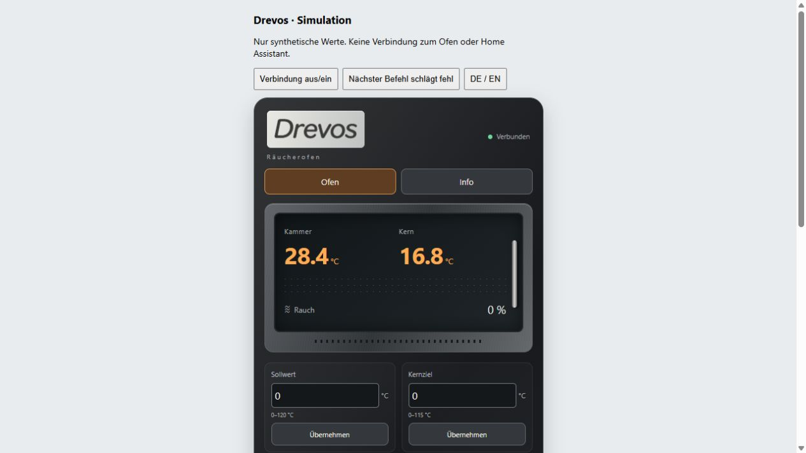
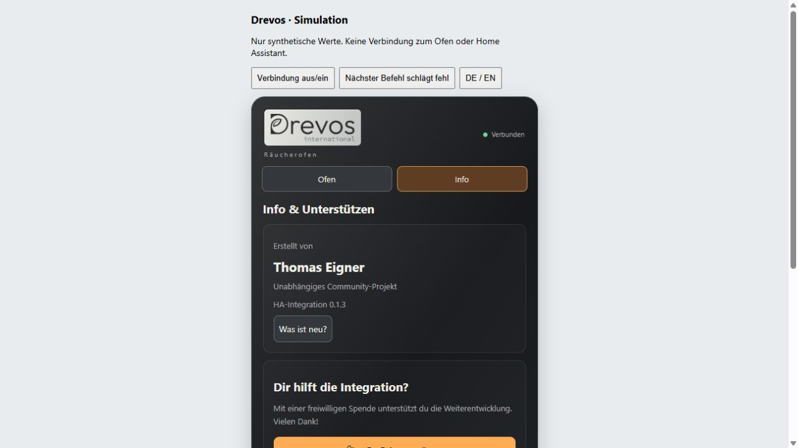

# Drevos Smoker – complete English guide

**License from 2026-11-21:** Free for private and internal business use; resale and commercial redistribution require **Thomas Eigner's prior written permission**. [Terms, earlier MIT versions and contact](docs/LICENSING.md).

**[Easy step-by-step Pi and HA installation](docs/INSTALLATION.en.md)** · **[Already have HA or the app? What to add](docs/HA-UND-APP.en.md)**

[Deutsch](README.de.md) · [Overview](README.md)

This integration connects Home Assistant directly to a Raspberry Pi beside a Drevos smoker. The Pi communicates with the existing PLC.

The supported profile is `drevos_fx3u_v1`. This is an independent community project. A matching brand does not establish controller compatibility: verify the [register profile](docs/REGISTER_PROFILE.md) before enabling writes. The oven's existing thermal protection, interlocks and original controls remain necessary.

## 1. Requirements

- Home Assistant 2026.3 or later, access to its configuration directory or a suitable community store. Actually validated versions are recorded in [VALIDATION.md](docs/VALIDATION.md).
- Raspberry Pi 3 B, 3 B+, 4 B or Zero 2 W as a **separate gateway**; HA can run on another computer.
- Raspberry Pi OS Lite with Python 3.11+, a microSD card and a suitable power supply.
- Ethernet or stable Wi-Fi to HA. A DHCP reservation is useful.
- An **electrically compatible USB PLC programming cable** and a verified connection to the controller. A chip such as FT232R alone does not establish correct levels or wiring. Do not substitute an arbitrary TTL adapter or connect the PLC directly to GPIO.
- Zero 2 W: a suitable USB OTG adapter for the programming cable.
- SSH access to the Pi and administrator access to Home Assistant.

See [HARDWARE.md](docs/HARDWARE.md) for board differences. All listed boards use the same Python gateway. Only the Pi 3 B+ is physically verified in this installation.

## 2. Prepare the Raspberry Pi

Install Raspberry Pi OS with Raspberry Pi Imager. Configure networking, hostname and SSH, boot the Pi, then attach the verified PLC cable. SSH keys are suitable for ongoing administration.

```sh
sudo apt update
sudo apt install python3 python3-venv git
ls -l /dev/serial/by-id/
git clone https://github.com/eignerth2010-byte/drevos-home-assistant.git
cd drevos-home-assistant
sudo sh scripts/install-gateway.sh
```

The installer creates a dedicated service account, Python environment and private configuration file. **It does not start the gateway.** It generates a unique private token locally without printing it in the installation log.

## 3. Configure the gateway

**Already using the app?** Follow [App → HA](docs/HA-UND-APP.en.md#b-the-app-works-add-home-assistant) before changing `bind`. It also updates the existing app service's local `gateway_url` so the app keeps working.

Open the configuration locally:

```sh
sudoedit /etc/drevos/gateway.json
```

| Field | Meaning |
|---|---|
| `id` | Keep this generated stable identifier. Changing it creates a different device in HA. |
| `name` | Your preferred device name. |
| `profile` | `drevos_fx3u_v1`; other PLC programs are not automatically compatible. |
| `token` | Individually generated secret, used only in HA setup. |
| `serial_port` | The verified stable path under `/dev/serial/by-id/`. |
| `bind` | Initially `127.0.0.1`. To reach the Pi from a separate HA computer, use the **Pi's own LAN address**. |
| `port` | Default: `8756`. |
| `allow_control` | Initially `false`. Set to `true` only after checking the profile and comparing readings with the original display. |

HTTP is intended for a trusted LAN and does **not** encrypt the token. Do not forward the gateway port to the Internet. For an untrusted network, use an HTTPS reverse proxy with a certificate trusted by HA. The integration verifies HTTPS certificates and does not follow redirects.

The token stays in `/etc/drevos/gateway.json`, readable only by the service account, and HA's protected integration configuration. It does not belong in a dashboard card, issue or GitHub repository.

**No other program may have the same serial port open when starting the gateway.** Then start the shared gateway:

```sh
sudo systemctl enable --now drevos-gateway.service drevos-native-poweroff.path
sudo systemctl status drevos-gateway.service --no-pager
```

The PLC program is not modified. The verified profile fixes serial settings to 38400 baud, 7 data bits, even parity and 1 stop bit.

## 4. Install the Home Assistant integration

### Community store

On HA with Marketplace, open **Settings → Marketplace**, add this repository as an integration using its repository link, download and restart HA. On older installations with HACS, add `eignerth2010-byte/drevos-home-assistant` as a custom repository of type **Integration**, download and restart. This does not mean the project is already listed in the official catalog. Read and accept the store's own notices yourself.

### Manual installation

Copy the entire `custom_components/drevos` directory into HA's configuration directory:

```text
<HA configuration>/custom_components/drevos/manifest.json
<HA configuration>/custom_components/drevos/config_flow.py
<HA configuration>/custom_components/drevos/www/drevos-smoker-card.js
```

Include all Python files, translations and `www`. Restart Home Assistant.

### Setup

1. Open **Settings → Devices & services → Add integration**.
2. Search for **Drevos Smoker**.
3. Enter the local gateway address, for example `http://drevos-pi.local:8756`, or the Pi's own address with its port.
4. Enter the private `token` from the local gateway configuration.
5. Assign the new device to your preferred HA area.

Use **Reconfigure** on the integration entry if its address or token changes. HA offers authentication recovery for an invalid token. Keep the stable gateway ID unchanged.

## 5. Add the complete smoker card

Open a dashboard, choose **Edit → Add card → Drevos Smoker**. Configure the title, language and device in the visual editor. With exactly one Drevos gateway, the device is selected automatically.

Alternatively use the manual card editor:

```yaml
type: custom:drevos-smoker-card
title: Drevos Smoker
language: en
```

The card includes temperatures, targets, smoke level, both fans, heating, smoke/ignition, timer and Pi shutdown. It loads no remote fonts, images or libraries and contains no gateway token. Unavailable readings and controls are not presented as current.

In storage resource mode, the integration registers the bundled JavaScript automatically. Fully reload the browser after first installation. If manual resource registration is needed, add this **JavaScript module** under dashboard resources:

```text
/drevos_static/drevos-smoker-card.js?v=0.1.4
```

In YAML resource mode, add the same module URL to the existing resource list. The integration does not edit that list. Avoid duplicate registrations. The version parameter changes on releases so browsers fetch fresh code.

## 6. Operation

| Function | Behavior |
|---|---|
| Chamber target | 0–120 °C in whole degrees. A positive value alone does not enable heating. Zero disables heat first. |
| Core target | 0–115 °C. Zero disables this completion criterion. A reached positive core target can end the process early. |
| Smoke target | 0–100%. A positive value alone does not start smoke. Zero disables smoke first. |
| Heating element | Enables the existing PLC heating control; requires a valid positive chamber target. |
| Smoke / ignition | Enables the PLC's existing smoke and ignition sequence; requires a positive smoke target. Never directly forces an ignition output. |
| Convection / fan | The confirmed manual PLC requests. The PLC can also run convection for heating or cooling. |
| Timer duration | 1–9999 minutes. |
| Timer start | Starts only the clock, without enabling heat or smoke. |
| Timer pause | Requires heat and smoke to be off. |
| Reset timer | Requires a paused timer and heat/smoke off; clears elapsed time. |
| Shut down Pi | Requires a stopped timer and heat/smoke off. It does not switch off the oven. Restart the Pi by restoring its power. |

Edit a number and press **Apply**. Draft input is separate from the PLC's confirmed reading. The card asks for confirmation before enabling heat or smoke.

Times are **hours:minutes:seconds**. The PLC owns the timer; it continues independently of an open dashboard. Its existing logic ends the process and resets requests and elapsed time. The original HMI may then restore its default duration. The verified installation uses 9000 minutes, or 150 hours. That display does not indicate an active process when the timer switch is off.

Manual writes are blocked during an automatic program and in unverified Fahrenheit mode. On a network outage, **unavailable does not mean the oven has been switched off**: its controller continues independently.


## Info, version and release notes

Select **Info** in the Drevos card for creator Thomas Eigner, the HA integration version, support button, setup guide, discussions and contributors. The card footer also shows its version. **What’s new?** appears once after an update per browser profile and can be reopened in Info. See [Info and updates](docs/UPDATES.md).

## 7. Update and roll back

**New: 0.1.4** replaces the manufacturer logo with a temporary community wordmark and square cabinet icon. Use remains free; resale and commercial redistribution require prior written permission. [License and earlier MIT versions](docs/LICENSING.md). The Pi gateway remains 0.1.1.

HA version **0.1.3** adds **Oven / Info** tabs, creator details, optional PayPal support, a visible version and **What’s new?**. The setup information displayed inside HA and these guides are also updated. The earlier 0.1.2 release removed the superseded mobile prototype. The standalone app is maintained only in the separate [app repository](https://github.com/eignerth2010-byte/drevos-app). The Pi gateway remains at 0.1.1.

Version **0.1.1** includes gateway 0.1.1, shared with the standalone app. Overlapping HA commands and writes to a busy serial connection are refused, not queued. Action errors are available in German and English. Existing entities and dashboard configuration are preserved. If the app setup already installed gateway 0.1.1, only this HA update is needed; no Pi reinstallation is required.

The current [standalone Android/iOS app](https://github.com/eignerth2010-byte/drevos-app) does not require Home Assistant. Both connections use the same local gateway service; never open the PLC port with a second service.

For **0.1.3**, update the HA integration in the **Marketplace** (HACS before HA 2026.11), restart HA and reopen the dashboard. The existing Pi gateway 0.1.1 needs no change. HA and app versions are numbered independently.

Back up the private Pi configuration and HA configuration first. Public releases contain no personal settings.

The following Pi commands apply to a separate gateway update:

```sh
cd drevos-home-assistant
git pull --ff-only
sudo systemctl stop drevos-gateway.service
sudo sh scripts/install-gateway.sh
sudo systemctl start drevos-gateway.service
```

The installer preserves an existing `/etc/drevos/gateway.json`. Update HA files through the store or replace `custom_components/drevos`, then restart HA and reload the browser. To roll back the HA integration, install the earlier version through the store and restart HA. When sharing the gateway with the standalone app, retain gateway 0.1.1. Preserve private configuration.

## 8. Troubleshooting

```sh
sudo systemctl status drevos-gateway.service --no-pager
sudo journalctl -u drevos-gateway.service -n 50 --no-pager
ls -l /dev/serial/by-id/
```

- **Cannot connect:** check Pi power, network, bind address and port. Loopback `127.0.0.1` is accessible only on the Pi.
- **Invalid authentication:** compare the private token locally and reconfigure HA. Never post it.
- **Unavailable temperatures:** check PLC power, verified adapter, stable device path, permissions and competing serial services.
- **Locked controls:** check `allow_control`, automatic mode, Celsius mode and valid targets.
- **Cannot pause:** switch heat and smoke off through their normal controls first.
- **Unknown card:** verify complete installation, HA restart, resource registration and browser reload.

HA diagnostics deliberately omit gateway address and token. Still review logs and screenshots for personal information before sharing them. An uncertain command is never retried automatically; check the actual oven state before retrying.

## 9. Remove or develop

Finish any active oven process first. Remove the integration through Devices & services, remove its cards and unused resource, delete `custom_components/drevos` and restart HA. Disable the Pi service and power-off watcher only if the standalone app or other clients no longer need them. Keep private configuration until another connection is confirmed working.

```sh
sudo systemctl disable --now drevos-gateway.service drevos-native-poweroff.path
```

See [GitHub publishing and maintenance](docs/GITHUB.md), [contributing](CONTRIBUTING.md) and [validation](docs/VALIDATION.md). There are no license fees for the [Free-use license](LICENSE).


## Preview



Original Drevos card for Home Assistant – isolated preview with sample values.



## Contributors

Created by **Thomas Eigner**, with AI assistance from **ChatGPT (OpenAI)** for development, software checks and documentation. [Contributor acknowledgements](CONTRIBUTORS.md).

## Support this project

If this project helps you, you can support its continued development with a voluntary donation via PayPal. Thank you!

[](https://www.paypal.com/donate/?hosted_button_id=GSMP9644VUY8C)

Or scan the QR code:

[](https://www.paypal.com/donate/?hosted_button_id=GSMP9644VUY8C)
