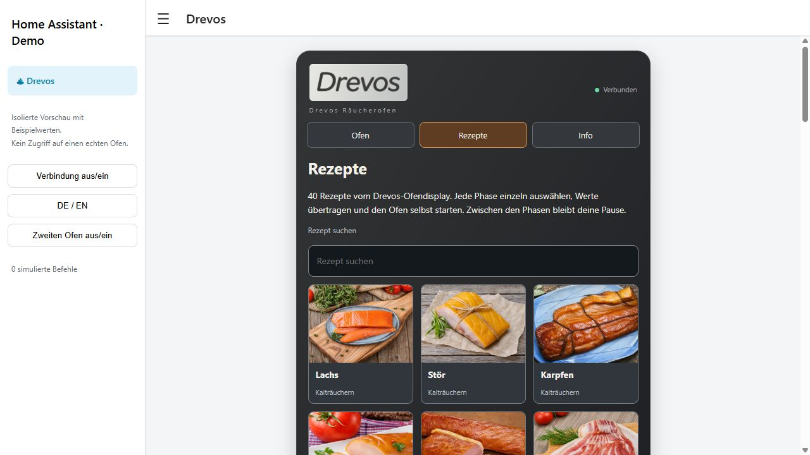
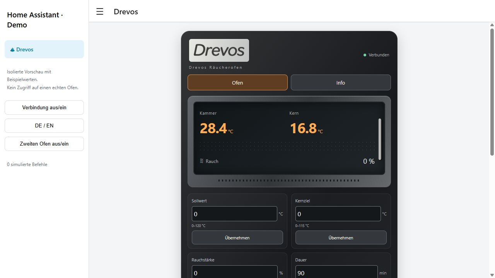
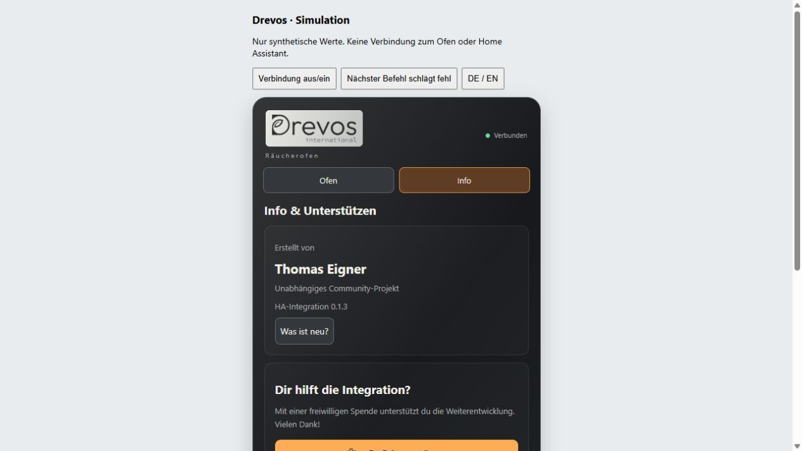

# Drevos Smoker for Home Assistant

<!-- ha-marketplace:exclude-start -->

  

  
  
  
  
  

Home Assistant 2026.11+: Marketplace · [Open in HACS on older installations](https://my.home-assistant.io/redirect/hacs_repository/?owner=eignerth2010-byte&repository=drevos-home-assistant&category=integration).
<!-- ha-marketplace:exclude-end -->

**Lizenzen:** HA-Integration und Karte bleiben unter [MIT](LICENSE) frei nutzbar und weitergebbar. Nur Pi-Software und Apps benötigen für Verkauf oder kommerzielle Weitergabe Thomas Eigners schriftliche Freigabe. [Genaue Abgrenzung](docs/LICENSING.md).

**Licenses:** HA integration and card remain [MIT licensed](LICENSE). Only Pi software and apps require written permission for resale or commercial redistribution. [Exact scope](docs/LICENSING.md).

**[Einfach starten – Pi und HA installieren](docs/INSTALLATION.de.md)** · **[Easy Pi and HA setup](docs/INSTALLATION.en.md)**

**Schon HA oder die App eingerichtet? [Was brauche ich zusätzlich?](docs/HA-UND-APP.de.md)** · [HA + app, English](docs/HA-UND-APP.en.md)

[Deutsch: vollständige Anleitung](README.de.md) · [English: complete guide](README.en.md)

Native, local Home Assistant integration for **one verified Drevos FX3U controller profile**, with a Raspberry Pi serial gateway and a bundled smoker-style dashboard card. The HA connection runs locally without a cloud service; private personal use is free.

**Community project, version 0.2.0. Not an official Drevos or Mitsubishi product.** Compatibility is defined by the register profile, not by the Drevos badge on an oven. Other controllers must be checked before enabling writes.

**Version 0.2.0** adds 40 recipes with restored photos and separately selected phases. Transfer numeric settings explicitly, then start controls yourself; no automatic next phase. [Recipe guide](docs/RECIPES.en.md). Since **0.1.5**, the integration adds **Drevos** to the HA sidebar automatically, with the complete smoker controls. No separate dashboard is required; existing dashboard cards still work. [Sidebar and troubleshooting / Seitenleiste](docs/SIDEBAR.md). The Pi gateway remains 0.1.1.

## What is included

- Automatic **Drevos** sidebar page, including separate cards for multiple ovens and an offline view.
- Chamber and core temperature, smoke level, setpoints and timer readings.
- Separate controls for heating, smoke with the PLC's automatic ignition sequence, convection and fan.
- Timer duration, start/pause, reset and guarded Raspberry Pi shutdown.
- A complete, responsive card with German/English text and a stainless-steel cabinet design.
- Info/support tab with creator Thomas Eigner, optional PayPal support, visible version and once-per-version release notes.
- GUI setup, reconfiguration, authentication recovery and redacted diagnostics.
- Raspberry Pi gateway, systemd installer, tests, examples, MIT-licensed HA code and separately licensed Pi software.

## Requirements at a glance

Home Assistant **2026.3+** (live validation is performed on the installed release; see [validation](docs/VALIDATION.md)), a separate Raspberry Pi 3 B / 3 B+ / 4 B / Zero 2 W with Raspberry Pi OS and Python 3.11+, a suitable power supply and microSD, network access, and an **electrically compatible PLC programming cable**. A USB chip name alone does not establish compatibility. The Zero 2 W also needs a USB OTG adapter for the cable.

All four boards use **the same gateway program**; the hardware differences are in the [hardware guide](docs/HARDWARE.md). Only the 3 B+ is physically verified in this installation.

## Install

1. Follow [the German guide](README.de.md) or [the English guide](README.en.md) to install the Pi gateway.
2. Install `custom_components/drevos` in Home Assistant, restart HA, then add **Drevos Smoker** under Devices & services.
3. Enter the gateway URL and its locally generated private token.
4. Open **Drevos** in the sidebar. Optionally add **Drevos Smoker** to an existing dashboard using the card picker. The integration registers its local sidebar panel and bundled card resource automatically.

Do not put gateway tokens or personal configuration in an issue, repository or screenshot. The installer defaults to loopback-only, read-only operation. See the full guide before exposing it to your trusted LAN or enabling controls.

## Documentation

- **[Rezepte: einfache Anleitung auf Deutsch](docs/RECIPES.de.md)** · [Recipes: English guide](docs/RECIPES.en.md) — 40 Originalrezepte, einzelne Phasen und eigene Vorschläge.

- [Sidebar page / Seitenleiste](docs/SIDEBAR.md).
- [Deutsch](README.de.md) / [English](README.en.md): complete installation, usage, update, rollback and removal.
- [Hardware and Pi models](docs/HARDWARE.md).
- [Verified register profile](docs/REGISTER_PROFILE.md).
- [Card Info, versions and updates / Karteninfos und Updates](docs/UPDATES.md).
- [Validation and limits](docs/VALIDATION.md).
- [Publishing and maintaining on GitHub, DE/EN](docs/GITHUB.md).
- [Contributing](CONTRIBUTING.md) · [Security](SECURITY.md) · [Third-party notices](THIRD_PARTY.md) · [MIT license for HA](LICENSE).

The original PLC project, its export, photographs, credentials and installation-specific configuration are deliberately not distributed. The integration never changes the PLC program and never forces a raw Y output.

## Separate standalone app

The current [standalone Android/iOS and Web App](https://github.com/eignerth2010-byte/drevos-app) is maintained in its own repository and works independently of Home Assistant. This repository contains only the HA integration, its dashboard card and local Pi gateway. Both connections can use gateway 0.1.1; only that gateway opens the PLC serial port. This HA update does not require reinstalling an existing gateway 0.1.1. Follow [the combined-use guide](docs/HA-UND-APP.en.md) when adding either client; LAN binding and the app bridge's local URL must agree.

Die [eigenständige Android-/iOS- und Web-App](https://github.com/eignerth2010-byte/drevos-app) hat ein eigenes Repository. Dieses Projekt enthält ausschließlich die HA-Integration, ihre Dashboard-Karte und das lokale Pi-Gateway.

## Vorschau / Preview

40 Rezepte in Seitenleiste und Karte; jede Phase einzeln vorbereiten, selbst starten und Pausen einhalten. Nur synthetische Beispielwerte. / 40 recipes in the sidebar and card; prepare and start each phase yourself, with breaks between phases. Synthetic demo only.

Drevos 0.1.5 – integrierte Seitenleistenansicht mit Beispielwerten. / Integrated sidebar page with synthetic values.

## Mitwirkende / Contributors

**Thomas Eigner** – Ersteller / creator. **ChatGPT (OpenAI)** – KI-Unterstützung bei Entwicklung, Tests und Dokumentation / AI assistance with development, software checks and documentation. [Details](CONTRIBUTORS.md).

## Unterstützen / Support

Wenn dir dieses Projekt hilft, kannst du die Weiterentwicklung mit einer freiwilligen Spende über PayPal unterstützen. Vielen Dank!

If this project helps you, you can support its continued development with a voluntary donation via PayPal. Thank you!

QR-Code scannen / Scan the QR code:

